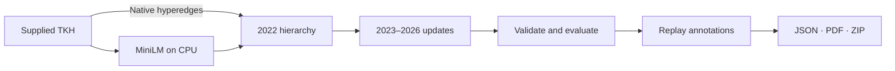
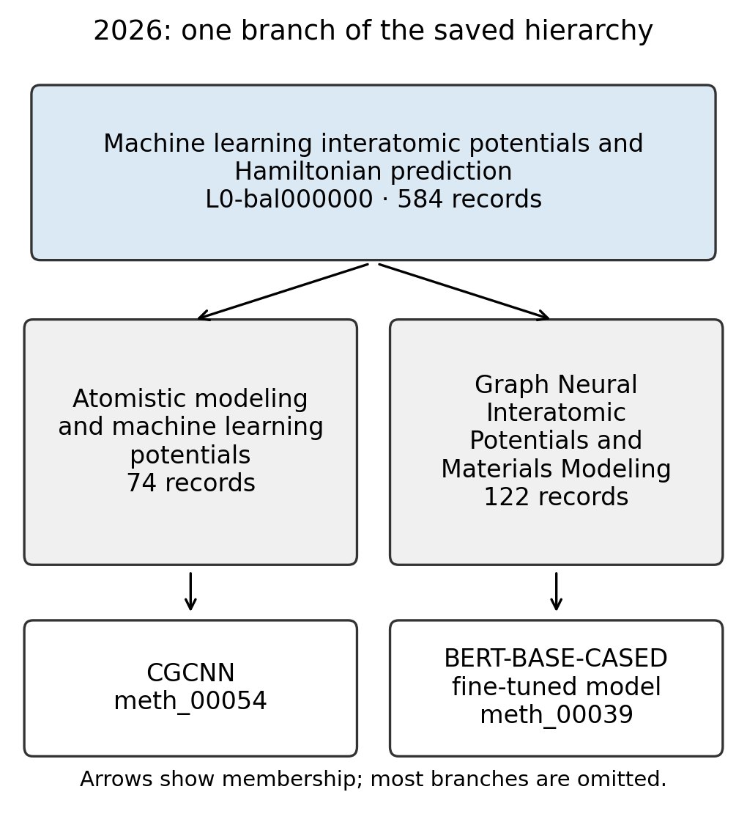
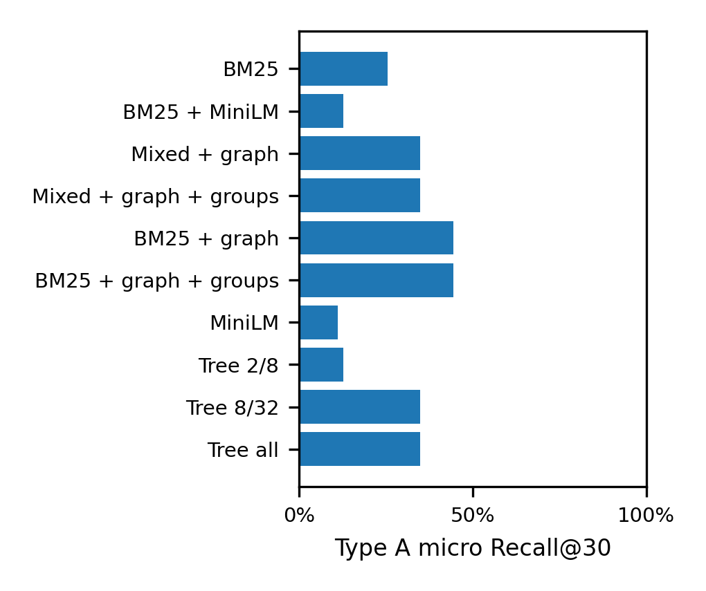

<div align="center">

# Temporal Knowledge Hypergraph

**A bounded, evolving map of scientific knowledge.**

Sentence embeddings · Native hypergraph partitioning · Incremental updates

[](pyproject.toml)
[](docs/CPU_RUN.md)
[](docs/DATA_SUMMARY.md)
[](results/verification/pre-publication-tests.log)

[**Read the paper**](report.pdf) · [How it works](#how-it-works) · [Results](#results) · [Reproduce](#quick-start) · [Specification checklist](docs/REQUIREMENTS.md)

</div>

---

Scientific records arrive as methods, datasets, components, claims and papers,
connected by relations that can involve several records at once. This project
organizes that hypergraph into nested views and carries the hierarchy forward as
new papers arrive, reusing earlier state and limiting changes to old assignments.

| Records at the final cutoff | Native hyperedges | Temporal views | Display budgets |
| :---: | :---: | :---: | :---: |
| **5,798** | **1,429** | **5 yearly snapshots** | **12 coarse / 50 fine** |

The repository contains the method, a reproducible evaluation, exported
hierarchies and a five-page research report. The study separates structural
correctness, topic quality, temporal stability, label faithfulness and retrieval
utility.

## Quick start

**Requirements:** Linux x86_64, Python 3.12 and GNU Make. No GPU or API key is
needed for the supplied reproduction.

```bash
git clone https://github.com/mkgs210/temporal-knowledge-hypergraph.git
cd temporal-knowledge-hypergraph
make all
```

One command creates an isolated `.venv-cpu`, installs pinned dependencies,
computes text vectors, builds and validates all five views, runs the evaluations,
authenticates saved labels, and generates the article, figures and review ZIP.

| Measured clean execution | Wall time |
| --- | ---: |
| Full command, including environment setup | **6 min 51 s** |
| Pipeline after environment setup | **5 min 49 s** |

These measurements used a new environment and fresh text vectors. Downloaded
model files and pip wheels were already cached; downloading them on another
machine adds time. [Per-stage timings and full logs →](docs/RUNTIME.md)

> [!NOTE]
> `make all` makes **zero new LLM API requests**. It replays authenticated naming
> and checking responses only when the rebuilt groups, evidence, prompts and
> settings match the supplied archive. Changed groups require fresh annotations.

<details>
<summary><strong>Output directories, repeat runs and individual stages</strong></summary>

The default output is `out/cpu/`, with timings in `out/cpu-timing.json` and a
transcript in `out/cpu.log`. An occupied output directory gets a new timestamped
name. Existing Python environments and exact-text embedding caches are reused.

```bash
# Build into a new directory using an existing Python environment.
make all OUT=out/my-run PYTHON=.venv-cpu/bin/python

# Validate or regenerate the report from the completed run.
make validate OUT=out/my-run
make pdf OUT=out/my-run
```

Fresh model annotations are an explicit separate operation: use `make labels`
and `make label-audit` with an NVIDIA key in the ignored `.env`, following
[.env.example](.env.example). Completed requests survive interruption. Resume
instructions and the local-only `make offline` scope are in
[CPU_RUN.md](docs/CPU_RUN.md).

</details>

## How it works

The hierarchy has three resolutions: **up to 12 coarse groups → up to 50 fine
groups in total → individual original records**. Every fine group has one coarse
parent; each record belongs to exactly one group at each level.



| Component | What it does |
| --- | --- |
| **Meaning and structure** | Combines cosine-neighbour evidence with a native multiway connectivity objective, using Mt-KaHyPar for partitioning |
| **Bounded views** | Enforces the 12/50 limits and nested membership independently of solver success |
| **Persisted updates** | Reloads checkpoints, retains old vectors and old-to-old affinities, and permits changes to at most 10% of old scientific paths per update |
| **Counted contraction** | Keeps original hyperedge identity, endpoint multiplicities, time and provenance in coarser views |

New records start from a nearby existing record's group. Refinement fixes paths
outside an affected region and penalizes changes inside it. The selected run
keeps fixed topic slots; adaptive discovery of new topics is not established.

<p align="center">
  
</p>

*An actual final-cutoff branch, selected deterministically by persistent IDs.
The names are generated automatically; most branches are omitted.*

The formal criterion, complexity, coarsening rules and literature discussion are
in the [paper](report.md). [Implementation and dependency provenance →](docs/CODE_ORIGIN.md)

## Results

**The hierarchy did not improve matched retrieval in this study.** The strongest
graph-assisted BM25 baseline finds 28 of 63 reference targets; adding hierarchy
transitions finds the same number. Narrow tree traversal loses targets.

The primary metric is Type A micro **Recall@30**, over **14 development questions
and 63 target occurrences**. Each hierarchy overlay shares its baseline's seed
search, original relations/source transitions, matching rules and denominator.

| Search | Found / targets | Recall@30 |
| --- | ---: | ---: |
| BM25 | 16/63 | 25.4% |
| BM25 + original relations/source | 28/63 | 44.4% |
| Same search + hierarchy | 28/63 | 44.4% |
| BM25 + MiniLM + original relations/source | 22/63 | 34.9% |
| Same mixed search + hierarchy | 22/63 | 34.9% |
| Coarse-first: 2 coarse / 8 fine | 8/63 | 12.7% |
| Coarse-first: 8 coarse / 32 fine | 22/63 | 34.9% |
| All branches | 22/63 | 34.9% |



Two component controls remove the native scientific cut term or the old-edit cap
and movement penalty. They share vectors, cutoffs, display budgets and search.
[Controlled comparisons →](docs/COMPONENT_CONTROLS.md)

<details>
<summary><strong>What these results establish — and where the evidence is limited</strong></summary>

- Budgets, complete membership, nesting, cutoff membership and counted contraction
  are executable invariants.
- Coherence uses held-out citation topology and a type/size-preserving random
  null. It is a relational proxy, not a percentage of scientifically correct groups.
- Five 10%-edge-deletion rebuilds measure perturbation robustness. Chronological
  agreement is partly enforced by constrained editing; process confidence
  intervals remain unavailable under source dependence.
- A blind audit of 20 labels yielded 16 accurate, four vague and zero wrong model
  ratings. This small sample does not establish universal faithfulness. Visible
  names overlap generator inputs, and both checking/generation models belong to
  the Nemotron family.
- The questions were inspected during development; no untouched final test is
  available. No retrieval gain or production speedup is claimed.

The [full report](report.pdf) retains uncertainty, failed checks and a four-week
next-work plan. [Complete requirement-by-requirement audit →](docs/REQUIREMENTS.md)

</details>

## Models and annotation evidence

| Model | Role | During `make all` |
| --- | --- | --- |
| `sentence-transformers/all-MiniLM-L6-v2` | 384-dimensional text embeddings for construction and semantic search | Real local CPU inference for uncached text |
| `nvidia/nemotron-3.5-lightning-30b-a3b` | Group labels and explanatory glosses | Authenticated saved responses |
| `nvidia/nemotron-3-ultra-550b-a55b` | Blind label-faithfulness checks | Authenticated saved judgments |

The encoder revision and dependencies are pinned. No model is fine-tuned. Naming
uses schema-constrained JSON; exact prompts, evidence, requests, responses and
earlier failed checks are retained in the compact
[annotation archive](annotations/README.md).

The supplied data contains extracted records and statements; full article texts
are not provided. [Data structure, growth and quality findings →](docs/DATA_SUMMARY.md)

## Explore the artifacts

| Artifact | Location |
| --- | --- |
| Research article | [PDF](report.pdf) · [Markdown](report.md) |
| Published per-year hierarchies and event logs | [results/labelled_hierarchy/snapshots/](results/labelled_hierarchy/snapshots/) |
| Numbers behind the report | [results/metrics.json](results/metrics.json) |
| Exact model annotation evidence | [annotations/](annotations/) |
| Runtime and reproduction evidence | [results/verification.json](results/verification.json) · [logs](results/verification/) |

<details>
<summary><strong>Files produced by a fresh run</strong></summary>

```text
out/cpu/
├── hierarchy/              # Raw views, checkpoints and temporal events
├── labelled_hierarchy/     # Validated views with authenticated labels
├── assets/                 # Newly calculated vectors and metadata
├── science/                # Coherence, perturbation and temporal checks
├── components/             # The two controlled method variants
├── labels/                 # Exact annotation and blind-audit records
└── metrics.json            # Measurements for this run

out/cpu.log                 # Complete stage transcript
out/cpu-timing.json         # Per-stage and total wall-clock times
out/cpu-submission.zip      # Full local review artifact
report.md / report.pdf      # Generated article
figures/                    # Generated hierarchy and retrieval figures
```

Vector caches, checkpoints and large intermediate artifacts are regenerated
locally and excluded from Git. Raw input data, published views, metrics, report
and compressed annotation evidence remain in the repository.

</details>

## Verification

The recorded release passed **472 tests**. The standalone checker validates JSON
Schema, complete partitions, parent nesting, hard budgets, cutoff membership and
event references. Deliberately broken overlap, overflow and dangling-parent
fixtures must fail. Growth tests add 100 synthetic source papers and check
preserved vectors, bounded groups and saved-state reuse.

```bash
make test
.venv-cpu/bin/python validate.py results
```

Source hashes and the complete clean execution are recorded in the
[verification evidence](results/verification.json). [AI_USAGE.md](AI_USAGE.md)
documents assistant use, major prompts, corrected mistakes and what was checked.

---

[Paper](report.pdf) · [Data](docs/DATA_SUMMARY.md) · [Run details](docs/CPU_RUN.md) · [Specification](docs/REQUIREMENTS.md) · [Code provenance](docs/CODE_ORIGIN.md)
