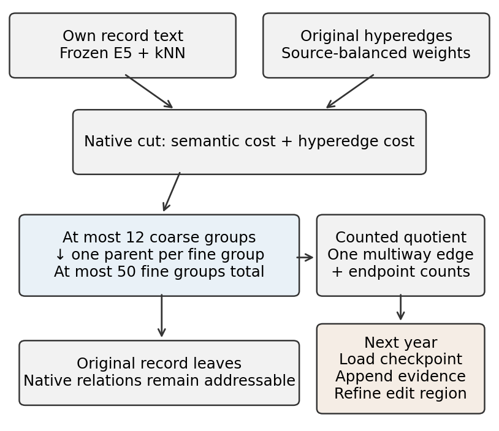
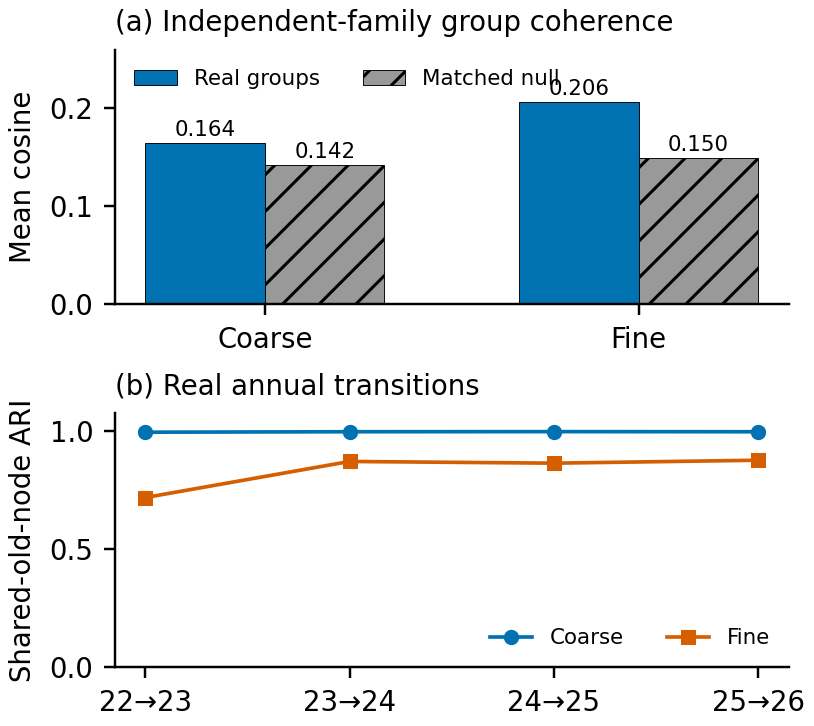
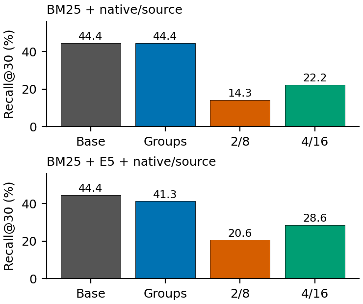

# Native Semantic Abstraction over an Evolving Knowledge Hypergraph

Research assessment · {{DATE}}

## Abstract

A temporal knowledge hypergraph requires nested scientific abstractions that remain coherent as papers accumulate. We study a native semantic/structural partitioning method with persisted updates and counted multiway coarsening. Frozen text embeddings supply semantic affinities; a hypergraph connectivity criterion supplies structural evidence. We evaluate structural correctness, independent-family coherence, temporal behavior, blinded group judgments and matched retrieval separately. On {{TOTAL_NODES}} records, independent coherence exceeds a size/type-preserving null, but this does not imply useful routing. Across {{A_QUESTIONS}} questions with {{A_TARGETS}} target occurrences, graph-assisted BM25 recovers {{BM25_GRAPH_HITS}} targets in its first 30 results; adding topic-group transitions recovers {{BM25_HIER_HITS}}. The corresponding BM25/E5 system changes from {{DENSE_GRAPH_HITS}} to {{DENSE_HIER_HITS}}. Restricting search to selected branches performs worse. The method supplies a reproducible structural abstraction, while explanatory labels, dependence-aware temporal uncertainty and positive hierarchy utility remain unresolved.

**Keywords:** temporal hypergraphs; semantic abstraction; graph coarsening; incremental partitioning; retrieval evaluation.

<!-- ARTICLE BODY -->

## 1. Introduction

Scientific knowledge graphs contain more information than a reader or retrieval procedure can inspect directly. A useful abstraction should expose broad concepts, allow drill-down to individual methods and preserve recognizable structure as the corpus evolves. Multiway relations make this different from ordinary graph clustering: replacing one relation by many pairwise edges can change its contribution to the partitioning objective. Temporal updates introduce another tension: preserving yesterday's topics may conflict with representing new evidence.

We investigate three separate questions. Can a native method produce legal nested partitions and track their identities? Do its groups exhibit meaning under evidence independent of the construction geometry? Does the additional hierarchy help retrieve known target records? These claims cannot substitute for one another. A stable hierarchy can preserve mistakes, and a structurally valid hierarchy can reduce search quality.

Our implementation combines semantic affinities with original hyperedges, contracts them into counted quotients and updates saved state under fixed outside-region assignments. The contribution is an auditable method and a controlled study, rather than a claim of a globally novel partitioning algorithm. The principal result is negative: additional topic-group transitions do not improve either strong retrieval baseline, and branch restriction loses targets. We retain this finding alongside positive structural checks and the unresolved labelling requirement.

## 2. Related Work

Native multilevel hypergraph partitioning provides scalable cut/refinement primitives [1]. We use its connectivity objective and balance controls, but native cut quality alone does not certify scientific topics. Graph reduction with spectral and cut guarantees [2] motivates specifying precisely what a coarse representation preserves. Those ordinary-graph guarantees are not inherited by our counted hypergraph quotient.

Leiden [3] shows why refinement and connected communities matter in graph clustering. Applying ordinary-graph modularity to a projection is a credible simpler alternative, but it does not directly satisfy the requirement to retain multiway relations. Dynamic hierarchical community processing [4] motivates persistent state and affected-region updates. Its graph setting and performance claims do not establish update locality or semantic quality here. We therefore measure the editable scope rather than infer efficiency from the presence of an update operation.

## 3. Data and Temporal Views

We use the supplied export without repairing raw dates or provenance. Every record receives one hierarchy path. Article/author nodes remain addressable metadata; other node types drive scientific partitioning. Full paper texts are unavailable in the supplied export and were not downloaded. Table 1 reports cumulative publication-availability views; they are not independent samples.

**Table 1.** Snapshot growth and native hyperedge arity. Science excludes article/author metadata; added records are relative to the preceding view.

{{SNAPSHOTS}}

A node must satisfy both declared observation and source-publication availability. A hyperedge appears only when its dates and every original endpoint are visible; endpoints are never dropped to force early admission. Later-source provenance and undated aliases are excluded from construction. The export lacks historical wording, so these retrospective views do not reconstruct ingestion chronology or month-level availability. The quality audit records {{QUALITY_ERRORS}} overlapping consistency violations, not that many scientifically false claims.

The construction encoder is fixed E5-base-v2, applied to each record's own surface form with the recorded query-prefix matching recipe, masked-mean pooling and unit normalization. No model is trained. Exact text/ID mappings, revisions and hashes are included as outputs of our own previous inference. Neither retrieval questions nor reference answers enter hierarchy construction. The corpus and evaluation family had nevertheless been inspected during development; all later comparisons remain exploratory.

## 4. Method

### 4.1. Criterion and hierarchy construction

At time t, the native hypergraph H(t)=(V(t),E(t)) receives a coarse partition, a fine partition and singleton original-node leaves. Fine groups have one coarse parent; hard budgets are {{BROAD_BUDGET}} coarse and {{FINE_BUDGET}} fine groups in total. Positive cosine similarities on symmetric maximum k-nearest-neighbor links, with k={{KNN}}, form derived semantic affinities. These pairs are distinct from the original multiway relations; native hyperedges are not replaced by a clique projection.

The design hypothesis is that text links can bring similarly named concepts together across papers, while native relations can keep scientifically connected but differently worded records together. Neither evidence source is sufficient alone: lexical similarity can join unrelated uses of a term, and one source paper can mention several topics. The hierarchy is an additional index over immutable input records, not a replacement for their original relations. The fine budget is global, not fifty children per coarse group; budgets are complexity limits rather than an estimated true number of scientific fields.

**Figure 1.** Method schematic, not measured results. Two evidence channels feed a native cut. Fine groups have exactly one coarse parent and original records remain drill-down leaves. Later views load the saved state and refine an explicitly declared region.

For a partition P, the working criterion is

$$
J(P)=\sum_{(u,v)}a_{uv}\,\mathbf{1}\{P(u)\ne P(v)\}
{}+\gamma\sum_{e\in E_t}w_e\,[\lambda_e(P)-1].
$$

Here lambda counts occupied groups. Eligible native scientific relations receive equal total mass per source paper. Provenance-only relations and article/author endpoints do not drive scientific cuts, while complete original edges remain in the exported abstraction. Initial normalization constants persist across updates.

The recorded calibration (Table 2) selects gamma={{GAMMA}} on the first view by maximizing the smaller independent null-adjusted coherence across both levels among the positive candidates. A semantic-only candidate is diagnostic. This choice is conditioned on an inspected development evaluator, not evidence of universally optimal weighting.

**Table 2.** First-view method variants under the same budgets. Excess cosine above a type/size-matched null is a development score; gamma zero removes native cut cost. Higher native weight does not improve this score. These variants have not all received the full final temporal, label and retrieval evaluation.

{{CALIBRATION}}

Construction first solves the combined coarse cut. It then repeatedly splits the current fine group with largest construction-vector dispersion and finally refines coarse parents on the counted fine-group quotient. Mt-KaHyPar supplies the native partition/refinement primitive [1]. This staged procedure is heuristic, not a global minimum of a joint objective over all levels. Integer conversion records a rounding bound; refinements violating constraints or increasing the checked floating criterion are rejected. Balance may separate parts of a genuinely large scientific topic.

### 4.2. Hyperedge collapse

For every original edge e and super-node g, collapse stores the number of original endpoints assigned to g:

$$
c_{eg}=\left|\{v\in e:P(v)=g\}\right|.
$$

An entirely internal edge remains an internal record with zero cut contribution. Partial collapse retains endpoint multiplicities. An edge spanning three or more groups remains one multiway relation. The coarse solver actually consumes this quotient; its objective is checked against the original assignment and full endpoint totals are conserved. The quotient loses within-group endpoint arrangement and fine textual distinctions. Original records remain available for drill-down. No spectral approximation guarantee is claimed.

For illustration, if e={a,b,c,d} and a,b enter A while c enters B and d enters C, the quotient stores one relation with counts {A:2,B:1,C:1}. Its total is still four and its connectivity contribution is two times its weight. If every endpoint enters A, the record stores {A:4} and contributes zero. This is a counting example, not a sampled scientific relation.

### 4.3. Persisted updates and cost

An update reloads the previous checkpoint, freezes old vectors and old-old affinity weights, and appends new-node affinities using fixed normalization. The result is an append-only affinity representation, not a recomputed global kNN graph. New relations, reweighted source edges and new semantic neighbors identify affected subtopics. Their members form the editable region; group-specific fixed terminals retain outside assignments. Coarse refinement moves whole fine groups. Automatic novelty-triggered birth/split/merge remains uncalibrated.

Exact initial neighbor work is O(n²d), and stored vectors, sparse affinities and incidences require O(nd+nk+I). A batch of b new records requires O(bnd) exact neighbor work. Solver work is additional and heuristic. Editable-region closure can approach the full graph, while validation and export still scan current inputs. Coverage, laminarity, budgets and endpoint accounting are checked; semantic adequacy and useful adaptation are empirical properties.

## 5. Experimental Protocol

### 5.1. Independent semantic evidence

Fixed Nemotron vectors, from a different encoder family, measure pair-weighted within-group cosine. Type-stratified random memberships preserve group sizes and node-type composition. Excess above that null is not a percentage of correct topics. Different families avoid grading E5 with its own optimization geometry; shared text and repeated evaluator inspection still limit independence. The independent evaluator was also used for first-view calibration and is a development criterion rather than a held-out final judge.

Historical blinded intrusion tasks provide a separate view. Fresh-context assistant judges saw anonymous member-text sets and selected an inserted outsider without method labels or answer keys. Actual responses, exclusions and ambiguity notes are retained. One judge per item, common model family with the developer and potentially ambiguous outsiders make this an exploratory LLM audit, not domain-expert truth. Wilson intervals are descriptive; regimes can be dependent.

### 5.2. Stability and downstream utility

Temporal adjusted Rand index (ARI) uses only shared old nodes. Persistent IDs, old-node moves and loaded-state traces additionally check vector, affinity and outside-region invariance. A historical sensitivity experiment rebuilds the initial view after deleting exactly floor(10%) of all original hyperedges under five masks. Conditional Student-t intervals describe corruption-mask variation on that fixed graph/model; they are not uncertainty for real chronological transitions.

Retrieval uses micro Recall@30 over {{A_QUESTIONS}} questions and all {{A_TARGETS}} target occurrences, including unreachable targets. The output filter admits {{ANSWER_NODES}} records of five types. Exact names or explicit aliases determine matches. This is known-target recovery, not scientific answer correctness or precision under complete relevance judgments. Source-recovery questions are evaluated separately.

BM25 indexes names/aliases, source titles and at most eight scientific neighbors. Optional E5 uses the fixed own-text passage/query cache. Ordinary propagation uses original hyperedge incidence and shared-source memberships. Every hierarchy pair preserves those channels, documents, filters and parameters. One intervention reserves a fixed transition share for coarse/fine memberships. Another first selects broad groups and their subtopics from initial scores, then walks only the induced original incidences. No full graph walk precedes selection. Two fixed widths are reported without choosing winners from reference answers.

All 14 substantive baseline specifications are compared with the same hierarchy. Five nested type-preserving random hierarchies and a stay-in-place control test whether extra mixing alone explains changes. Complete previous baseline top100 rankings and unrestricted all-branch traversal reproduce exactly. Predictions and controls are frozen before reference scoring. Paired bootstrap intervals resample whole questions and retain their target sets.

### 5.3. What structural integrity means

We test three different properties. First, a standalone validator checks complete, disjoint coverage at every level, one valid parent per child, exact parent/child membership unions, group budgets, original endpoint references and legal event references. Deliberately corrupted fixtures introduce overlap, an exceeded budget and a dangling parent; each must be rejected. Passing these checks establishes a legal representation, not meaningful topics.

Second, contraction checks compare original endpoint totals with summed quotient counts and evaluate the same assignment before and after contraction. Third, update traces require a loaded previous checkpoint, no call to the initial builder, unchanged old-old affinities, and unchanged assignments outside the declared editable region. Persistent IDs permit direct counting of moved old records; ARI additionally compares pairwise grouping independently of ID names. Old membership inside the region may change: the method preserves state and constrains edits, but does not promise an entirely immutable tree. Removing ten percent of edges and rebuilding probes sensitivity to damaged evidence, a different question from annual updates.

## 6. Results

### 6.1. Group meaning and temporal behavior

Table 3 reports recomputed independent-family evidence for the final view. Coherence exceeds its matched null, but the intrusion judgments in Table 4 are mixed. Different evaluators therefore do not support a single unqualified claim of good scientific topics.

**Table 3.** Final-view pair-weighted cosine and type/size-matched null.

{{COHERENCE}}

**Table 4.** Historical blinded outsider detection. These small assistant-judged samples are not expert topic accuracy.

{{BLIND}}

Coarse assignments change little across years; finer assignments change more (Table 5). Annual edit regions cover most scientific records. High coarse stability therefore does not establish small computational work, novelty sensitivity or scientific correctness. Real-transition confidence/significance remains unestimated because connected nodes and adjacent years are dependent.

**Table 5.** Shared-old-node ARI and changes of persistent group membership.

{{TRANSITIONS}}

**Table 6.** Initial-view edge-deletion sensitivity. Intervals vary five deletion masks, not years or scientific populations.

{{PERTURBATION}}

**Figure 2.** Two distinct quality checks. Top: final-view mean cosine versus twenty type/size-preserving null permutations, using the independent encoder family (Table 3). Bottom: shared-old-node ARI across actual annual updates (Table 5). These are descriptive scores, not percentages of correct topics; chronological confidence intervals are unavailable.

All {{INTEGRITY_VIEWS}} views pass structural validation and preserve endpoint totals and quotient objective values. All {{UPDATE_COUNT}} later views load previous state, avoid the initial builder, retain old-old affinities and pass outside-region invariance. Nevertheless, declared editable regions span {{EDITABLE_MIN}}–{{EDITABLE_MAX}} of current scientific nodes. Every annual coarse-refinement proposal is rejected by objective or validity/balance guards and the prior coarse assignment of fine groups is retained. These observations explain why a near-one coarse ARI cannot by itself demonstrate a strong adaptation algorithm or cheap local updates.

### 6.2. Matched retrieval

Table 7 separates initial search/ordinary propagation from the added hierarchy. Both strong baselines fail to improve under group transitions; choosing branches discards many targets. Figure 3 shows the same comparison as recall percentages. The beneficial effect of original graph/source links must not be attributed to the additional topic hierarchy.

**Table 7.** Known targets found in the first 30 results. Within a row only hierarchy use changes. Columns 2/8 and 4/16 retain that many broad/fine groups.

{{RETRIEVAL}}

**Figure 3.** Matched Recall@30 for the two strong baselines. The axis starts at zero; labels identify the actual percentage. All initial node scores are still computed, so a smaller later traversal scope does not establish end-to-end speedup.

**Table 8.** Group-transition controls for the strong baselines. Random-group ranges cover five fixed permutations. Delta is the paired change in micro Recall@30 with its question-bootstrap interval.

{{RETRIEVAL_CONTROLS}}

<!-- ARTICLE END -->

Real groups do not establish an advantage over the random-group controls. Small improvements on weaker configurations cannot demonstrate a general hierarchy benefit after many exploratory comparisons. These results favor retaining graph-assisted BM25 for known-target recovery on this benchmark. They do not establish that hierarchical routing should be deployed as an accuracy improvement.

## 7. Discussion and Limitations

All coarse/fine glosses still list representative member names rather than explain a common scientific subject. Exact membership and input hashes prevent unsupported membership claims, but do not establish scientific faithfulness. No disjoint label-support assessment or independently measured over-claim rate exists for the final method. Intrusion judgments assess composition and cannot repair this missing evaluation. The explanatory-labelling requirement remains unmet.

Other limitations are the inspected evaluator/benchmark, incomplete historical wording, missing real-temporal intervals and uncalibrated novelty edits. Perturbation intervals cannot replace chronological uncertainty. A projected ordinary-graph pipeline is a credible alternative, but requires an explicit account of lost multiway information. A flat index with provenance-aware expansion is a simpler downstream alternative and outperforms the tested routing policies. Negative results for these policies do not prove that every hierarchy method is ineffective.

With four additional weeks, we would first replace list labels with scientific descriptions and separate generation evidence from blind support/adequacy assessment. Next we would calibrate novelty-sensitive edits and dependence-aware temporal uncertainty with source-level controls. Finally we would fix retrieval/navigation policies before evaluating genuinely unseen questions, evidence support and total computational work. These are proposed studies, not additional results.

## 8. Reproducibility and Conclusion

The single command rebuilds chronological partitions, validates snapshots, recomputes independent coherence and matched retrieval, and generates every numerical table/figure from metrics. Frozen per-text vectors enable CPU replay without model weights or other assessment participants' implementations. Initial calibration, deletion-mask studies and blinded answers are authenticated historical observations, not repeated neural inference or fresh judging. The standalone validator also rejects intentional overlaps, budget overflow and dangling parents. Assistance, concrete errors and their corrections are disclosed in AI_USAGE.md; procedural research guidance [5] does not certify validity.

The method provides a native, persisted and structurally checked abstraction with empirical coherence above a matched null. The strongest retrieval comparisons do not support an added hierarchy advantage. Scientific labels, temporal uncertainty and adaptive novelty remain open. This separation of verified properties from unresolved claims is the central conclusion of the study.

## References

[1] L. Gottesbüren, T. Heuer, P. Sanders, and S. Schlag. Scalable Shared-Memory Hypergraph Partitioning. ALENEX, 2021. https://doi.org/10.1137/1.9781611976472.2

[2] A. Loukas. Graph Reduction with Spectral and Cut Guarantees. JMLR, 20(116):1–42, 2019. https://jmlr.org/papers/v20/18-680.html

[3] V. A. Traag, L. Waltman, and N. J. van Eck. From Louvain to Leiden: guaranteeing well-connected communities. Scientific Reports, 9:5233, 2019. https://doi.org/10.1038/s41598-019-41695-z

[4] G. Bokov et al. A Parallel Hierarchical Approach for Community Detection on Large-scale Dynamic Networks. 2025 preprint version. https://arxiv.org/abs/2502.18497v1

[5] T. Kassis et al. Scientific Agent Skills: A Library of Procedural Knowledge for Research Agents. 2026. https://doi.org/10.48550/arXiv.2609.00065
